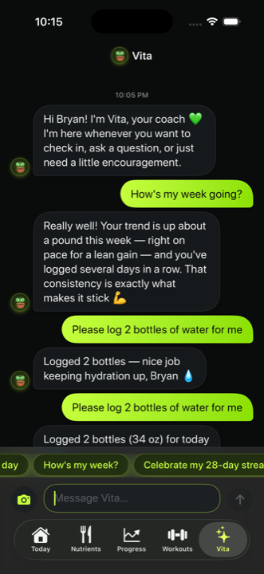
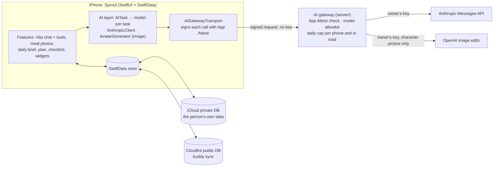
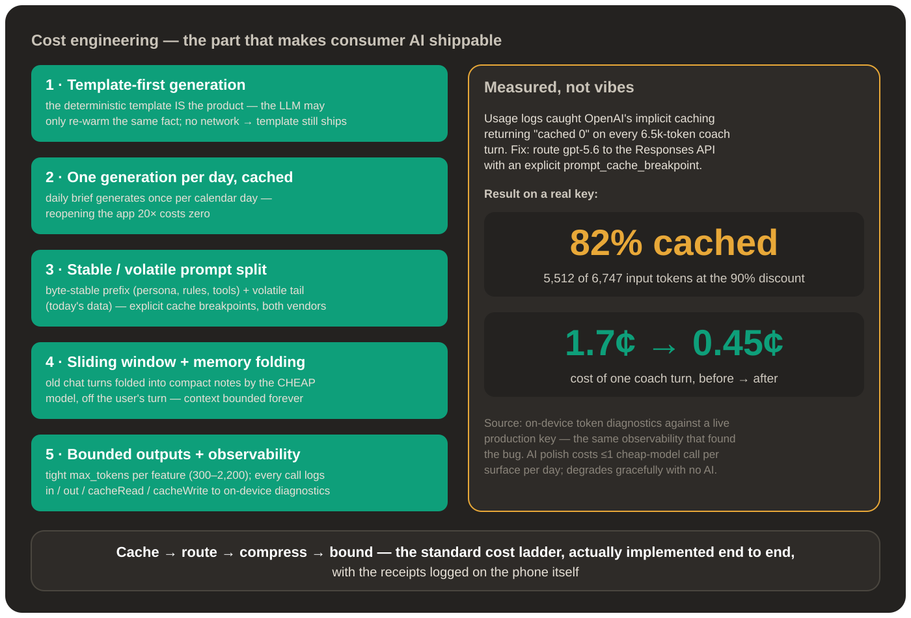
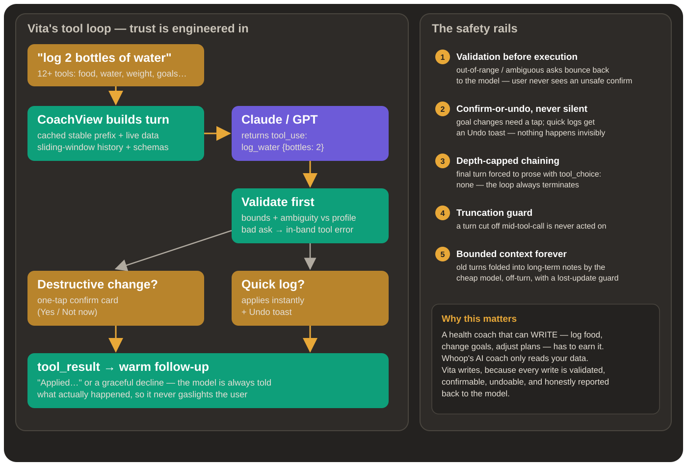
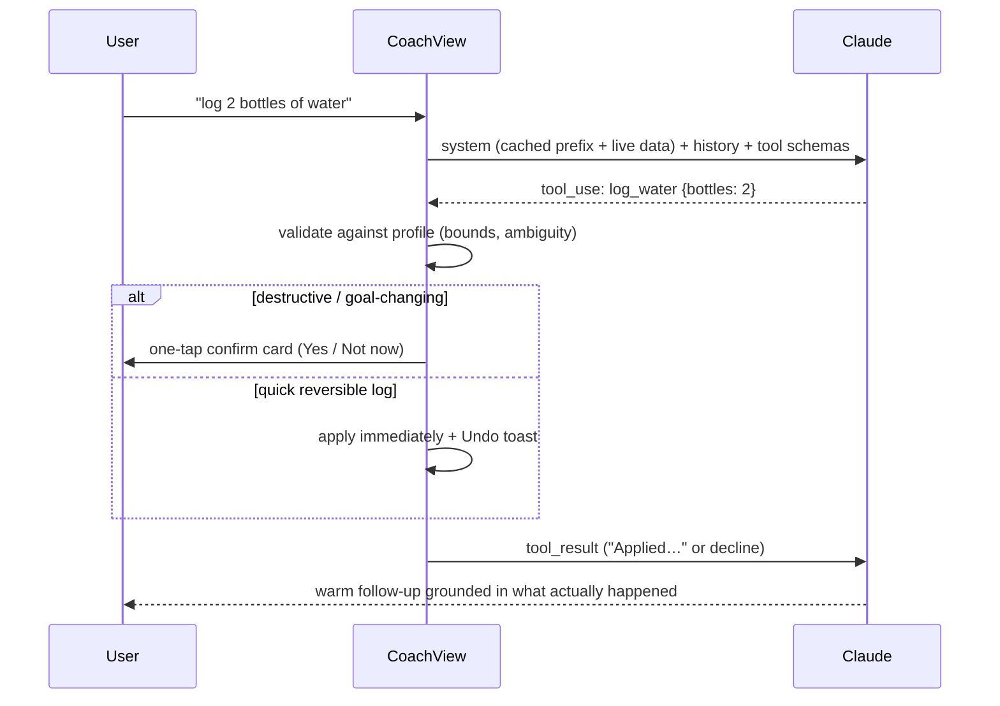
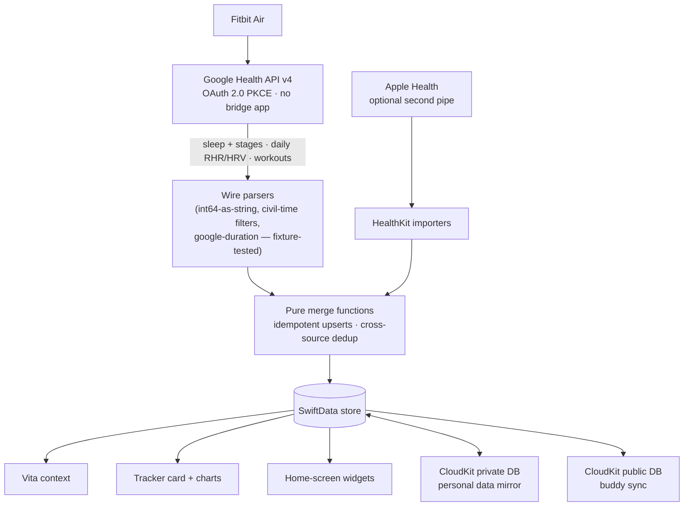
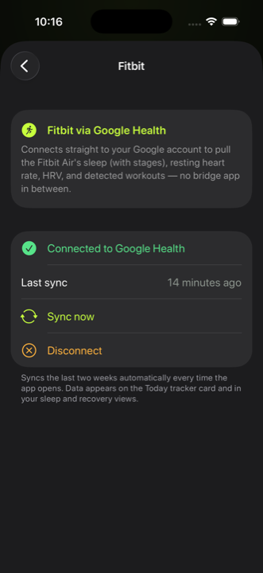
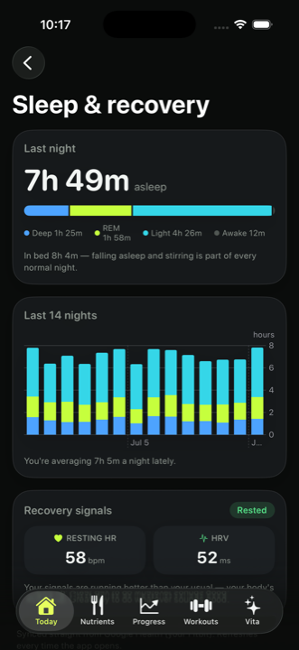

# Sprout

<div align="center">

[](https://swift.org)
[](https://developer.apple.com/xcode/swiftui/)
[](https://developer.apple.com/documentation/swiftdata)
[](https://www.anthropic.com)
[](https://github.com/bryanrg22/sprout/actions/workflows/ci.yml)

</div>

> **An AI health coach for iOS, and a case study in shipping consumer AI carefully: a model chosen per task by measurement, aggressive cost engineering, real tool use with safety rails, and a working fallback for every AI feature.**

Native SwiftUI + SwiftData. People install it from TestFlight and it simply works: there is no API key to enter. The AI runs through a small gateway that holds the keys and only answers genuine copies of the app.

---

## Contents

* [What is Sprout?](#what-is-sprout)
* [Architecture](#architecture)
* [The AI system](#the-ai-system)
  * [A model per task, chosen by measurement](#a-model-per-task-chosen-by-measurement)
  * [Cost engineering](#cost-engineering-the-part-that-makes-it-shippable)
  * [Tool use with safety rails](#tool-use-with-safety-rails)
  * [Data, context, coaching](#reading-the-body-data--context--coaching)
* [The data platform](#the-data-platform)
* [How it is verified](#how-it-is-verified)
* [Repository layout](#repository-layout)
* [Getting started](#getting-started)

---

## What is Sprout?

| Today | AI coach with tool use | Trend + AI plan | AI-personalized checklist |
|---|---|---|---|
|  |  |  |  |

**Sprout** is a healthy-habits companion built around **Vita**, an AI coach that reads the person's real data (food, water, weight trend, sleep and recovery from Fitbit or Apple Health, workouts, even timezone changes) and acts on it through validated tools. It is built to reward eating *enough* rather than eating less: no badge, chart or message ever praises restriction.

The second screenshot is the interesting one: *"Please log 2 bottles of water for me"* → the model emits a tool call, the app validates it and applies it to the local store (with Undo), returns a tool result, and the model confirms what actually happened.

---

## Architecture



* **The app** never holds an API key. A call carries a placeholder and goes to the gateway, signed by the phone's Secure Enclave key (App Attest), with the body bound into the signature, so a captured request can be neither replayed nor altered.
* **The gateway** ([`server/`](server/README.md), Node + SQLite, 58 tests) checks the signature, the phone's allowance for the day and the total for everyone, refuses any model the app does not use, forwards the call with the owner's key, and prices it from the provider's own usage report.
* **Health data never touches the server.** It lives in the SwiftData store, mirrored to the person's private iCloud database.

---

## The AI system

**Design stance:** an LLM is a component, not a product. Every feature is designed backwards from *"what's the cheapest thing that does this job honestly?"*: templates first, small models second, big models only where they earn it, and a working fallback when there is no AI at all.

### A model per task, chosen by measurement

Each AI feature is a task (`AITask`, 15 of them) with its own prompt and output contract. A task's model is chosen by running the candidate models on a versioned dataset of cases and comparing accuracy, cost and latency ([`Evals/`](Evals/README.md), results in [`docs/EVAL_REPORT.md`](docs/EVAL_REPORT.md)). A measured choice is written into `AIConfig.measuredDefaults` together with the report section that justifies it, and a test fails if one is missing its citation. A task with no measurement yet runs on its price tier's default, and the table says so.

| Task | Model | How it was chosen |
|---|---|---|
| Daily brief, insight line, weekly reflection, onboarding note, memory fold | `claude-haiku-5-5` | **measured**: as good as or better than the previous model on the rules, at about a seventh of the cost, and faster; a blind judge read all but the daily brief and favoured the old model on none, the weekly note clearly the new one. The memory fold's one defect (storing a calorie target) is removed in code (EVAL_REPORT 10, 25, 35, 36) |
| Progress recap, daily checklist | `claude-sonnet-5` | **measured**: the cheaper model is worse beyond noise, on the recap's numbers and on the checklist's plans as the judge reads them (EVAL_REPORT 35, 36) |
| The character picture | `gpt-image-2.6-sunburst`, low quality | **measured**: every candidate usable; cheapest in the style wanted (EVAL_REPORT 23, 27) |
| Vita chat turn, chat chips | `claude-haiku-5-5` | **measured**: over 30 multi-turn conversations a blind judge preferred it to `claude-sonnet-5` (50 to 15, an interval above zero), with the right tool as often, at an eighteenth of the cost; on the chips both were perfect on the rules and the judge leaned its way (EVAL_REPORT 36, 37, 38) |
| Food suggestions | `claude-sonnet-5` | **measured**: within noise overall, but the cheaper model's misses are the feature's point (meat suggested to a vegetarian, a food re-pitched) (EVAL_REPORT 36, 38) |
| Meal description, meal photo | `claude-sonnet-5` | **measured**: from household measures it is within 20% on 92% of meals against 83%, and from photos of weighed plates on 46% against 19% (31% mean error, between people at 41-53% and models trained on the photos at 19-26%) (EVAL_REPORT 37) |
| Adaptive plan: build, review, web research | `claude-opus-4-8` | tier default (rare: a few calls per person); no dataset yet |

The gateway allows exactly these models, and a unit test reads the gateway's price table and fails if any task resolves to a model it would refuse.

### Cost engineering (the part that makes it shippable)



| Technique | Where | Effect |
|---|---|---|
| **Template-first generation** | Daily brief, insights, reflections, onboarding | The deterministic template *is* the product; the LLM may only re-warm the same fact. No AI / no network → template ships. AI polish costs ≤1 cheap-model call per surface per day. |
| **Response caching (per-day)** | Daily brief | One generation per calendar day, cached in `UserDefaults` — reopening the app 20× costs zero. |
| **Prompt caching, stable/volatile split** | Coach chat (~6.5k-token prompt) | The system prompt is split into a byte-stable prefix (persona, rules, tool guidance) and a volatile tail (today's data). On Anthropic the prefix carries an explicit `cache_control` breakpoint → cached reads bill at ~10% of input price. |
| **Sliding window + memory folding** | Coach chat | Only recent turns are sent verbatim; older turns are folded into compact long-term notes by the *cheap* model, off the user's turn, with a lost-update guard. Context stays bounded forever. |
| **Bounded outputs** | Every structured call | Tight `max_tokens` per feature (300–2,200) — a schema-forced call can't ramble. |
| **Priority ladder, one message** | Daily brief | Google-Health-style proactive note picks ONE topic per day (comeback > milestone > cross-signal > quiet-day > check-in) instead of spamming generations. |
| **Token observability** | Every call | `in / out / cacheRead / cacheWrite` logged per request to on-device diagnostics — "what does a day of AI cost" is answerable from the phone. |

### Tool use with safety rails



Vita has a real toolbelt (log food/water/weight/workouts, edit entries, change goals, remember facts, adjust the plan). The loop is engineered around trust:



- **Validation before execution** — out-of-range or ambiguous requests bounce back to the model as in-band tool errors; the user never sees a confirm for something unsafe.
- **Confirm-or-undo, never silent** — destructive changes require a tap; quick logs apply instantly with an undo toast. Declines are told to the model so it responds gracefully.
- **Depth-capped chaining** with `tool_choice: none` on the final turn (schemas stay in the request — required when history contains tool blocks — but the model must finalize in prose).
- **Truncation guard** — a turn cut off mid-tool-call is never acted on.

### Reading the body: data → context → coaching

The AI is only as good as what it can see. Vita's context window gets a compact, pre-digested snapshot — not raw streams:

- **Sparse daily aggregates by design**: one row per night of sleep (with deep/REM/light stages), one per day of resting HR + HRV, one per detected workout. Enough signal for coaching; tiny prompt/storage/privacy footprint.
- **Recovery signal** (Whoop's idea at honest resolution): today's RHR/HRV vs the user's own 14-day baseline → rested / steady / tender. Requires ≥5 baseline days; refuses to guess. A copy-contract unit test bans clinical/alarming language.
- **Gap awareness**: `daysSinceLastLog` reframes a comeback ("she was away, don't read missing logs as not eating") — the streak logic, charts, insights, and Vita's tone all shift together.

---

## The Data Platform



| Fitbit, connected direct | Real sleep + recovery, same night |
|---|---|
|  |  |

**Direct Google Health integration** — OAuth 2.0 with PKCE in `ASWebAuthenticationSession`, tokens Keychain-only, single-flight refresh, `invalid_grant` auto-disconnect, and a zombie-token guard (a disconnect during an in-flight refresh can't resurrect the connection). The wire layer was built from Google's own discovery document, and its quirks — int64s as JSON strings, `"1234s"` durations, civil-time filter grammar — are pinned by tests so a parser regression is caught in CI, not on a phone.

**Idempotency as a contract** — every ingest path funnels through pure, unit-tested merge functions: re-running any sync N times produces identical rows (proven by a two-pass integration test against a real store). Workouts arriving through *both* pipes are deduped symmetrically by time-window, whichever pipe delivered first.

**Buddy sync** — two paired users share daily snapshots through CloudKit's public DB with deterministic record IDs and silent-push refresh; a privacy toggle controls whether a buddy sees everything or only the activity face-off. Sync health is user-visible (publish status, staleness warnings, one-tap diagnostic).

**One small server, on purpose.** The app has no backend for its data: health data stays in the SwiftData store and the person's own iCloud, and buddy sync rides CloudKit. The only server is the AI gateway (`server/`), which exists so that nobody using the app needs an API key: it holds the keys, accepts calls only from a genuine copy of the app (Apple App Attest), pays only for the models the app uses, and caps each phone's daily spend.

**Every feature degrades gracefully** — no AI on a device (no App Attest) → templates and manual logging still work; no network → the coach apologizes kindly; no tracker → the app is still a complete manual logger. AI is seasoning, not a dependency.

---

## How it is verified

* **Unit tests (about 1,200)**: wire-format fixtures for both providers, the coach's turn engine on scripted replies, App Attest signing against a fake gateway, store verification through the real SwiftData store and by SQL, idempotent merges, the RFC 7636 PKCE vector, timezone-crossing sleep bucketing, and copy-contract tests that ban clinical or shaming language.
* **UI flows (XCUITest)**: onboarding in every order, logging, the chat with a scripted model, mode switching, each with an accessibility audit.
* **Evaluations**: every model choice is measured on a dataset, recorded in a numbered, append-only report, with the raw run records committed under `Evals/runs/`.
* **The gateway**: 58 tests, including Apple's nine attestation checks against a test certificate authority, replay, tampering, the caps and the allowlist.
* **Records**: [`docs/EVAL_REPORT.md`](docs/EVAL_REPORT.md) (what was measured and decided), [`SproutTests/LEDGER.md`](SproutTests/LEDGER.md) (what each test file proves and does not), [`CHANGELOG.md`](CHANGELOG.md).
* **Field diagnostics**: tap the version number 7 times for a shareable log of every AI call (with token counts), sync outcome and lifecycle event.

---

## Repository layout

```
Sprout/            the app: App/, Features/, Models/, Services/ (AI/, GoogleHealth/, …)
SproutWidgets/     home-screen widgets
Shared/            code compiled into both the app and the widgets
SproutTests/       unit tests, and LEDGER.md: what each test file covers
SproutUITests/     XCUITest flows
SproutEvals/       the live evaluation harness (its own scheme; calls real models)
Evals/             evaluation datasets, scripts, prices and committed run records
server/            the AI gateway (Node, TypeScript, SQLite, Docker + Caddy)
tooling/           CloudKit schema checks, evidence capture
docs/              developer guide, release, evaluation report, feature specs, diagrams
project.yml        XcodeGen spec (Sprout.xcodeproj is generated from it)
```

See [`docs/README.md`](docs/README.md) for a map of the documentation.

## Getting started

1. `brew install xcodegen`, then `xcodegen generate` and open `Sprout.xcodeproj`.
2. To build your own copy, change `DEVELOPMENT_TEAM`, the bundle id, the iCloud container and the App Group in `project.yml` to yours (they keep the `com.bryanram.victoria` names the app shipped under; see [`docs/testflight.md`](docs/testflight.md)). iCloud is optional: without it the app runs fully local.
3. AI: the Simulator cannot do App Attest, so for AI in a DEBUG build pass your own key with the `SPROUT_ANTHROPIC_KEY` launch environment variable (never compiled into a Release build). Or deploy your own gateway ([`server/README.md`](server/README.md)).
4. Fitbit (optional): [`docs/google-health-setup.md`](docs/google-health-setup.md).
5. Tests and evaluations: [`docs/DEVELOPING.md`](docs/DEVELOPING.md).

---

*Built by Bryan Ramirez-Gonzalez. AI pair-engineering was used heavily, with every change gated behind the test suite and live verification.*
