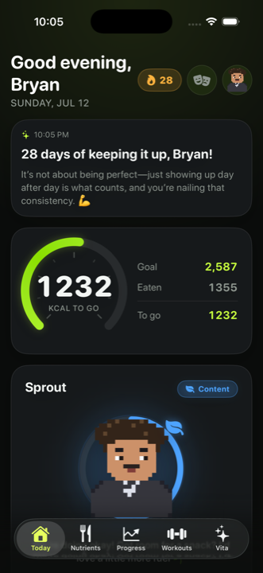
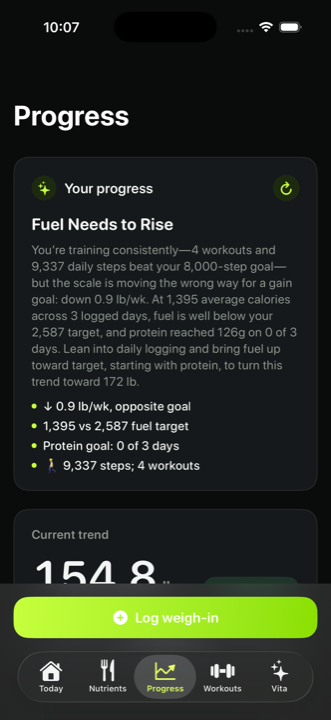
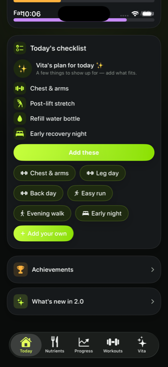
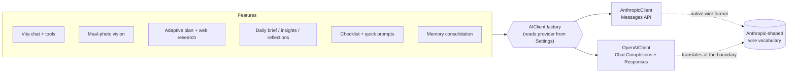
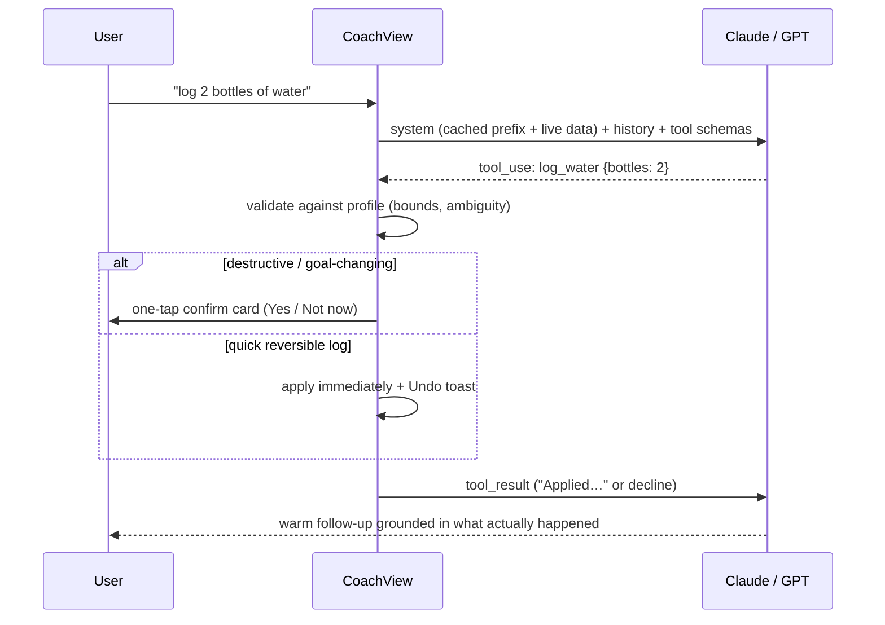
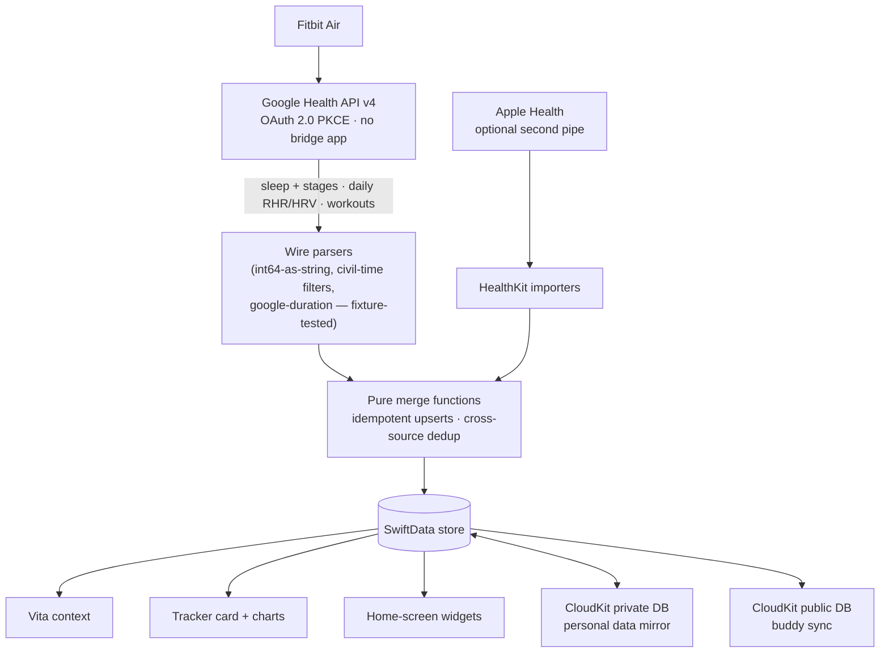

# 🌱 Sprout

**A warm, AI-coached health companion for iOS — and a working case study in doing consumer AI *right*: the correct model for each job, aggressive cost engineering, real tool use with safety rails, and graceful degradation everywhere.**

Built native in SwiftUI + SwiftData for a real person (my friend Victoria — and now me), running daily on real Fitbit data. Not a demo: every AI surface below is live, unit-tested, and was verified end-to-end against both the Anthropic and OpenAI production APIs.

| Today | AI Coach with tool use | Trend + AI plan | AI-personalized checklist |
|---|---|---|---|
|  |  |  |  |

> The middle screenshot is the interesting one: *"Please log 2 bottles of water for me"* → the model emits a **function call**, the app validates + applies it to the local store (with undo), returns a tool result, and the model confirms — a full agentic round-trip inside a consumer chat UI. Works identically on Claude and GPT.

---

## The AI system

**Design stance:** an LLM is a component, not a product. Every feature below was designed backwards from *"what's the cheapest thing that does this job honestly?"* — templates first, small models second, big models only where they earn it, and a working fallback when there's no key or no network.

### One abstraction, two providers

The user picks Anthropic or OpenAI in Settings (bring-your-own-key; keys live only in the Keychain). Every AI feature — chat with tools, vision, structured outputs, web-search research — runs on either vendor:



The trick that keeps this cheap to maintain: the app speaks **one internal wire vocabulary** (Anthropic's content-block format — messages, tool schemas, tool results). `OpenAIClient` translates at its boundary: tool schemas → function declarations, `tool_use` echoes → `tool_calls` with JSON-string arguments, `tool_result` → `role:"tool"` messages, base64 image blocks → data-URL parts. Call sites never branch on the vendor. The translation layer is pinned by fixture tests, including a full round-trip test (response → parse → echo → identical request).

### Right-sized models (the tiering)

| Tier | Anthropic | OpenAI | What runs on it | Why |
|---|---|---|---|---|
| **Cheap/fast** | Haiku 4.5 | gpt-4.1-mini *(deliberately non-reasoning)* | Daily brief polish, insight phrasing, weekly reflection, onboarding note, memory folding | Rewording precomputed facts needs zero reasoning — a reasoning mini would burn hidden thinking tokens inside 80–420-token budgets |
| **Strong** | Sonnet 5 | gpt-5.6-terra *(reasoning pinned low; none on tool turns — a live-discovered 5.6 constraint)* | Vita chat + tools, meal-photo vision, checklist, quick prompts | The $2.50–3 workhorse class; upgraded the moment newer generations hit price parity |
| **Heavy (rare)** | Opus 4.8 | gpt-5.6-sol | The one-time adaptive plan build/review + live web-search research | Runs a handful of times *ever* per user — worth the tokens. Fable 5 evaluated and rejected (2× price, no transfer to this workload) |

The expensive model is reserved for the feature invoked a few times per month; the model invoked many times per day is the cheap one. Users can override any model string in Settings without a rebuild. **Every choice here has a written defense with rejected alternatives and standing revisit triggers: [docs/MODEL_CHOICES.md](docs/MODEL_CHOICES.md).**

### Cost engineering (the part that makes it shippable)

| Technique | Where | Effect |
|---|---|---|
| **Template-first generation** | Daily brief, insights, reflections, onboarding | The deterministic template *is* the product; the LLM may only re-warm the same fact. No key / no network → template ships. AI polish costs ≤1 cheap-model call per surface per day. |
| **Response caching (per-day)** | Daily brief | One generation per calendar day, cached in `UserDefaults` — reopening the app 20× costs zero. |
| **Prompt caching, stable/volatile split** | Coach chat (~6.5k-token prompt) | The system prompt is split into a byte-stable prefix (persona, rules, tool guidance) and a volatile tail (today's data). On Anthropic the prefix carries an explicit `cache_control` breakpoint → cached reads bill at ~10% of input price. |
| **Cache-shard routing** | Coach chat on OpenAI | Our own usage logs caught OpenAI reporting `cached 0` on back-to-back 6.5k-token calls. Root cause: OpenAI load-balances across backends, each with its own cache — so without a routing key the warm cache is never re-hit. Fix: a constant [`prompt_cache_key`](https://developers.openai.com/api/docs/guides/prompt-caching) per feature (documented to lift hit rates from ~39% → ~95%). |
| **Sliding window + memory folding** | Coach chat | Only recent turns are sent verbatim; older turns are folded into compact long-term notes by the *cheap* model, off the user's turn, with a lost-update guard. Context stays bounded forever. |
| **Bounded outputs** | Every structured call | Tight `max_tokens` per feature (300–2,200) — a schema-forced call can't ramble. |
| **Priority ladder, one message** | Daily brief | Google-Health-style proactive note picks ONE topic per day (comeback > milestone > cross-signal > quiet-day > check-in) instead of spamming generations. |
| **Token observability** | Every call | `in / out / cacheRead / cacheWrite` logged per request to on-device diagnostics — "what does a day of AI cost" is answerable from the phone. This observability is literally how the cache-shard bug above was found. |

### Tool use with safety rails

Vita has a real toolbelt (log food/water/weight/workouts, edit entries, change goals, remember facts, adjust the plan). The loop is engineered around trust:



- **Validation before execution** — out-of-range or ambiguous requests bounce back to the model as in-band tool errors; the user never sees a confirm for something unsafe.
- **Confirm-or-undo, never silent** — destructive changes require a tap; quick logs apply instantly with an undo toast. Declines are told to the model so it responds gracefully.
- **Depth-capped chaining** with `tool_choice: none` on the final turn (schemas stay in the request — required when history contains tool blocks — but the model must finalize in prose).
- **Truncation guard** — a turn cut off mid-tool-call is never acted on.

### Reading the body: data → context → coaching

The AI is only as good as what it can see. Vita's context window gets a compact, pre-digested snapshot — not raw streams:

- **Sparse daily aggregates by design**: one row per night of sleep (with deep/REM/light stages), one per day of resting HR + HRV, one per detected workout. Enough signal for coaching; tiny prompt/storage/privacy footprint.
- **Recovery signal** (Whoop's idea at honest resolution): today's RHR/HRV vs the user's own 14-day baseline → rested / steady / tender. Requires ≥5 baseline days; refuses to guess. A copy-contract unit test bans clinical/alarming language.
- **Gap awareness**: `daysSinceLastLog` reframes a comeback ("she was away, don't read missing logs as not eating") — the streak logic, charts, insights, and Vita's tone all shift together.

---

## The data platform



**Direct Google Health integration** — OAuth 2.0 with PKCE in `ASWebAuthenticationSession`, tokens Keychain-only, single-flight refresh, `invalid_grant` auto-disconnect, and a zombie-token guard (a disconnect during an in-flight refresh can't resurrect the connection). The wire layer was built from Google's own discovery document, and its quirks — int64s as JSON strings, `"1234s"` durations, civil-time filter grammar — are pinned by tests so a parser regression is caught in CI, not on a phone.

**Idempotency as a contract** — every ingest path funnels through pure, unit-tested merge functions: re-running any sync N times produces identical rows (proven by a two-pass integration test against a real store). Workouts arriving through *both* pipes are deduped symmetrically by time-window, whichever pipe delivered first.

**Buddy sync** — two paired users share daily snapshots through CloudKit's public DB with deterministic record IDs and silent-push refresh; a privacy toggle controls whether a buddy sees everything or only the activity face-off. Sync health is user-visible (publish status, staleness warnings, one-tap diagnostic).

**Every feature degrades gracefully** — no key → templates and manual logging still work; no network → the coach apologizes kindly; no tracker → the app is still a complete manual logger. AI is seasoning, not a dependency.

---

## Verification culture

- **423 unit tests** — wire-format fixtures for both providers, the RFC 7636 PKCE test vector, timezone-crossing sleep bucketing, idempotent-merge integration tests against real SwiftData stores, and copy-contract tests (the recovery signal's own test once caught the word "medical" in coach copy and failed the build).
- **Live end-to-end, both vendors** — chat, tool calls, and data persistence verified against production APIs; results cross-checked three ways: UI screenshots, direct SQLite inspection of the store (zero duplicate rows after concurrent syncs), and the on-device diagnostics log.
- **Field diagnostics** — tap the version number 7× for a shareable log of every AI call (with token counts), sync outcome, and lifecycle event. Several real bugs in this repo were found by reading it.
- **Adversarial review loop** — independent review passes over every major feature; findings get fixed *with* regression tests (see the git history: the launch-race, cache-shard, and provider-parity fixes all landed with tests pinning them).

## How this compares to the industry

| Pattern | Who else does it | Here |
|---|---|---|
| LLM coach over wearable aggregates | [Whoop Coach (GPT-4, OpenAI partnership)](https://www.whoop.com/us/en/thelocker/whoop-unveils-the-new-whoop-coach-powered-by-openai/) | Vita: same architecture, plus *write* access via validated tools — Whoop's coach only reads |
| One proactive daily AI note | Google Health app's daily brief | Priority-ladder brief, template-first, ≤1 cheap call/day |
| AI memory of the user | [Whoop's 2025 roadmap](https://www.whoop.com/us/en/thelocker/inside-look-whats-next-for-whoop-in-2025/) | Shipped: consolidated long-term notes + explicit `remember_about_user` tool |
| Model routing by task complexity | [Standard cost-optimization practice](https://www.truefoundry.com/blog/llm-cost-optimization) (cache → route → compress) | Three explicit tiers per provider; heavy tier gated to a rare feature |
| Prompt caching | Anthropic/OpenAI native | Both: explicit breakpoints on Anthropic, shard-routing keys on OpenAI — with on-device logs proving hit rates |

## Project map

```
Victoria/
├── App/                  # Entry, root refresh orchestration (single-flight, ordered pipes)
├── Features/
│   ├── Coach/            # Vita: chat UI, tool loop, context builder, toolbelt (12+ tools)
│   ├── Dashboard/        # Today: brief, tracker card, checklist, companion
│   ├── Buddy/            # CloudKit public-DB pairing + daily snapshot sync
│   ├── Plan/             # Adaptive plan: intake → heavy build w/ web research → review
│   ├── Weight/ Food/ Workout/ …
│   └── Settings/         # AI provider picker, Fitbit connect, Apple Health, goals
├── Services/
│   ├── AI/               # the provider layer: AIConfig, LLMClient, Anthropic + OpenAI clients
│   ├── GoogleHealth/     # OAuth PKCE + REST client + sync orchestration
│   ├── DailyBriefService / DailyInsightEngine / RecoverySignal / CoachMemoryService
│   └── HealthKit* / StreakCalculator / Diagnostics …
├── VictoriaTests/        # 423 tests
└── docs/                 # screenshots, deep-dives, GOOGLE_HEALTH_SETUP.md
```

## Running it

1. `brew install xcodegen && xcodegen generate` → open `Victoria.xcodeproj`
2. AI: Settings → AI Provider → pick a vendor, paste your own API key (Keychain-only)
3. Fitbit: follow [GOOGLE_HEALTH_SETUP.md](GOOGLE_HEALTH_SETUP.md) (~15 min, one-time Google Cloud setup)
4. Everything works without steps 2–3 — that's the point.

---

*Built by Bryan Ramirez-Gonzalez as a daily-use app for a real person first, and a demonstration of production AI engineering second. AI pair-engineering was used heavily in development — with every change gated behind the test suite and live verification, which is rather the point.*
